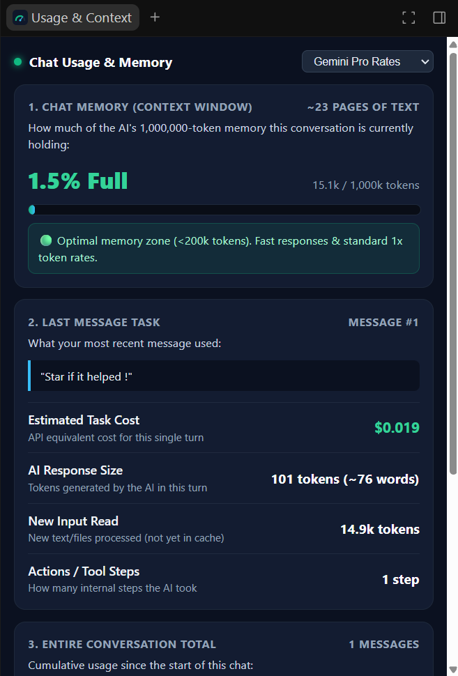

# Antigravity Usage & Context Monitor

A lightweight, zero-token auxiliary sidecar and slash command plugin for Google Antigravity. It monitors active conversation memory (context window saturation), per-turn token consumption, prompt cache reuse rates, model quotas, and estimated API expenses in real time.

<div align="center">
  
</div>

---

## Overview

Large-context models retain conversation history across turns, which steadily accumulates token load and can trigger higher pricing tiers once crossing threshold limits (such as the standard 200k boundary).

This plugin provides continuous visibility into your conversation's active memory and model usage directly within Antigravity's side panel, without calling language models or consuming tokens to perform its calculations.

---

## Key Features

- **Zero-Token Overhead:** Reads local conversation logs (`transcript.jsonl`) directly from disk. The monitor operates as an offline background process and never generates model calls.
- **Context Window Utilization:** Tracks memory usage against the 1,000,000-token limit, displaying both percentage fullness and equivalent page volume, with visual warnings as you approach long-context thresholds.
- **Turn & Session Metrics:** A consolidated two-column view comparing the most recent turn's resource footprint (new input tokens, generated output tokens, tool step count, and estimated cost) against cumulative conversation totals.
- **Cache Hit Monitoring:** Tracks prompt caching efficiency, reporting the exact percentage of conversation history read at cached rates.
- **Live Model Quota Tracking:** Interacts with Antigravity's local language server to detect configured models (e.g., Gemini 4 Argon, Gemini 3.8 Flash, Claude Sonnet 5.5) and displays remaining quota percentages alongside countdown timers to reset.
- **Built-in `/usage-stats` Command:** An integrated slash command to generate a formatted Markdown usage summary directly inside the chat stream whenever needed.

---

## How It Works

1. **Local Transcript Ingestion:** Antigravity logs conversation activity to `transcript.jsonl` under each conversation directory in `~/.gemini/antigravity/brain/`. The sidecar server monitors file modifications and parses exact token counts reported by the model.
2. **IPC Integration:** The server interfaces with Antigravity's internal language server over local IPC to retrieve active client model configurations and quota windows without external API roundtrips.
3. **Compaction Detection:** Automatically tracks `/compact` checkpoint operations, resetting the active context estimation immediately.

---

## Installation

Clone this repository into your Antigravity plugins directory:

### Windows (PowerShell)
```powershell
git clone https://github.com/MohamedTaherBorgi/Antigravity-Live-Usage-Context-Monitor-Plugin.git "$HOME\.gemini\config\plugins\usage-monitor"
```

### macOS / Linux
```bash
git clone https://github.com/MohamedTaherBorgi/Antigravity-Live-Usage-Context-Monitor-Plugin.git ~/.gemini/config/plugins/usage-monitor
```

### Activation
1. In Antigravity, open **Customizations &rarr; Plugins**.
2. Toggle **Antigravity Live Usage & Context Monitor** (`usage-monitor`) to **Enabled**.
3. Python 3 (`python` in system PATH) is required to run the local sidecar runtime.

---

## Usage

### Auxiliary Side Panel
Once enabled, open the **Usage & Context** view from the side panel or run the sidecar command to open the live dashboard. The view refreshes every 1.5 seconds while active.

### In-Chat Slash Command
At any point in a conversation, type:
```text
/usage-stats
```
This executes the companion analysis script and prints a breakdown of your current context state, last turn usage, and conversation totals directly in chat.

---

## Project Structure

```text
usage-monitor/
├── plugin.json                    # Plugin manifest
├── README.md                      # Documentation
├── assets/
│   ├── logo.svg                   # Plugin icon
│   └── preview.png                # Dashboard interface preview
├── sidecars/
│   └── usage-monitor/
│       ├── sidecar.json           # Sidecar registration configuration
│       └── server.py              # Local HTTP runtime & dashboard server
└── skills/
    └── usage-stats/
        ├── SKILL.md               # Slash command specification
        └── scripts/
            └── get_usage.ps1      # Transcript analytics script
```

---

## License

MIT License. Contributions and improvements are welcome.
